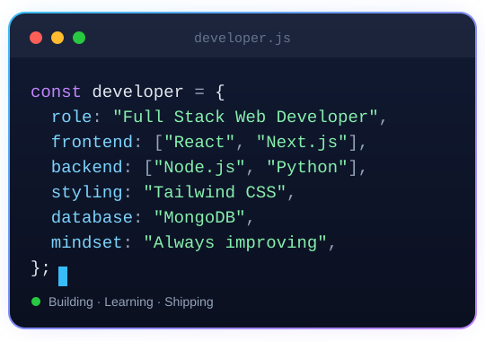

<!-- ───────────── BANNER ───────────── -->

  

 

<!-- ───────────── ABOUT ME ───────────── -->
<table>
  <tr>
    <td width="55%" valign="top">

## 👨‍💻 About Me

### Full Stack Web Developer · CSE Graduate

Hi, I'm **Dibosh Sarker**, a Full Stack Web Developer and Computer Science & Engineering graduate based in Dhaka.

I build modern, user-friendly web applications, from responsive interfaces to REST APIs and database-driven features. I enjoy turning ideas into real-world projects, exploring emerging technologies, and continuously sharpening my development skills.

- 🔭 **Currently working on:** [bazar-dor](https://github.com/NeoPhyt000/bazar-dor) and [fit-log](https://github.com/NeoPhyt000/fit-log)
- 🌱 **Currently exploring:** Next.js and TypeScript for full stack web apps
- 🎯 **Focus:** Building clean, responsive, user-friendly web applications
- 💬 **Open to:** Collaboration, internships and learning from other developers
- 📍 **Based in:** Dhaka, Bangladesh
- 📫 **Reach me:** [diboshsarker45@gmail.com](mailto:diboshsarker45@gmail.com)

</td>
    <td width="45%" align="center" valign="middle">
      
    </td>
  </tr>
</table>

---

## 🌐 Connect With Me

  
  
  
  

---

## 💻 Tech Stack

**Frontend**

       

**Backend & Database**

    

**Tools & Platforms**

  

---

## 📌 Pinned Projects

<!-- Auto-updated from your GitHub pinned repositories (Customize your pins) -->
<!-- PINNED:START -->
<table>
  <tr>
    <td width="50%" align="center"></td>
    <td width="50%" align="center"></td>
  </tr>
</table>
<!-- PINNED:END -->

## 🐍 Contribution Activity

<!-- Animated snake: updated daily by .github/workflows/snake.yml -->
<picture>
  <source media="(prefers-color-scheme: dark)" srcset="https://raw.githubusercontent.com/NeoPhyt000/NeoPhyt000/output/github-snake-dark.svg" />
  <source media="(prefers-color-scheme: light)" srcset="https://raw.githubusercontent.com/NeoPhyt000/NeoPhyt000/output/github-snake.svg" />
  
</picture>

---

## 📊 GitHub Stats

  
  

  

---

  

